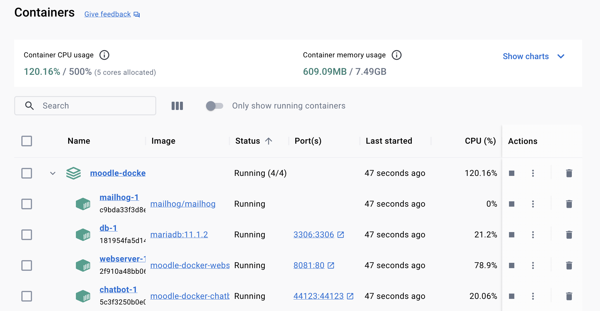
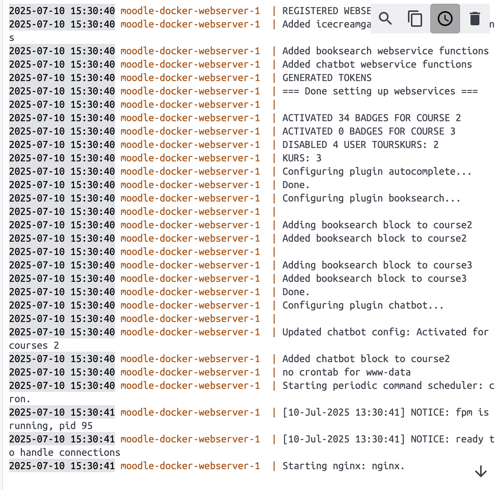
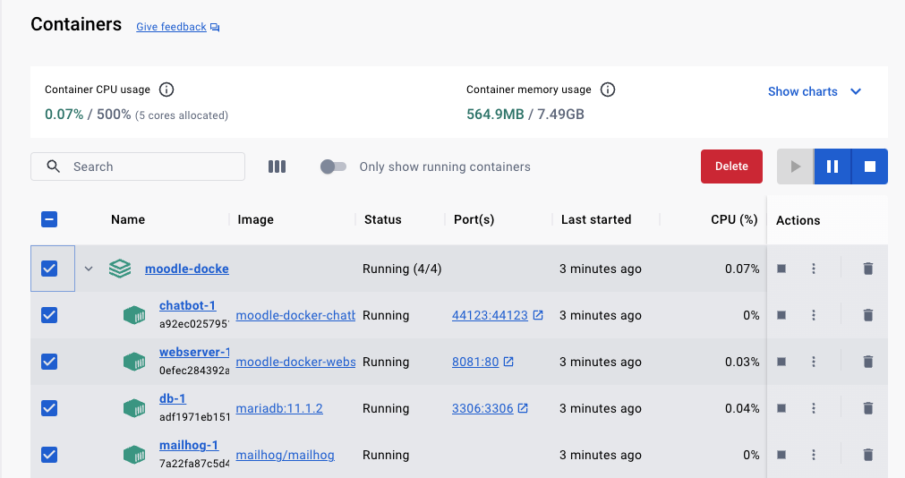
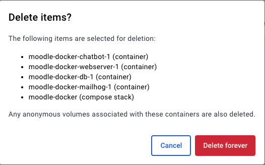
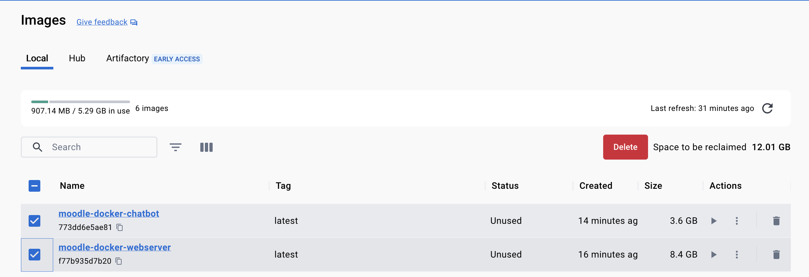
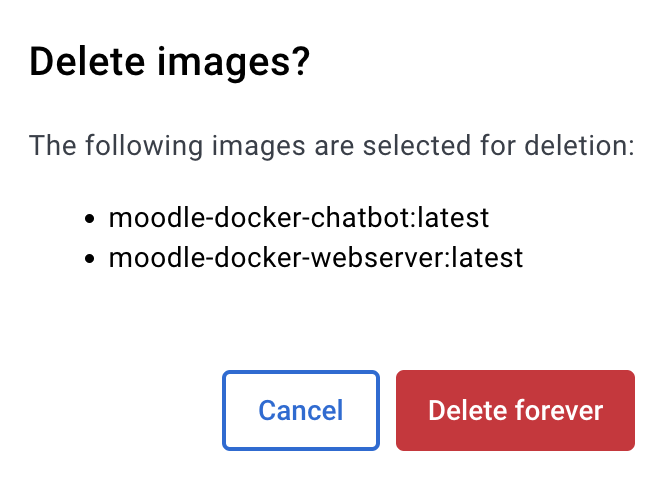
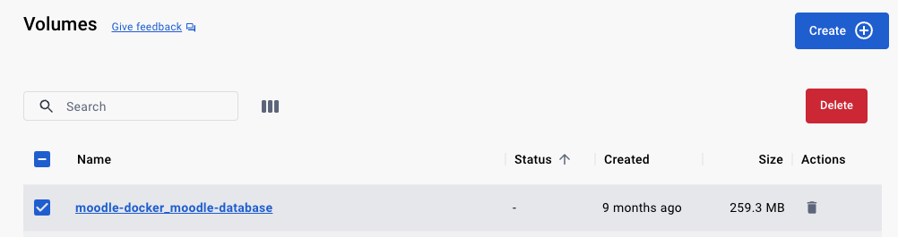
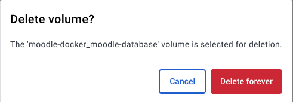

# moodle_docker

Automated Distribution of Moodle, Plugins and Teaching Materials for the KIB3 Courses (Currently only Zusatzqualifikation, we will add support for DQR5 soon).

## Installation 
0. Install [Docker desktop](https://www.docker.com/products/docker-desktop/)
   (FOR WINDOWS USERS: Requires to [activate optional windows feature](https://learn.microsoft.com/en-us/windows/application-management/add-apps-and-features) `Windows Subsystem for Linux` - see the [German WSL Installation Guide](https://github.com/SE-Stuttgart/kib3_moodle_docker/blob/main/install_wsl.md))
1. Clone this repository (or download as a .zip file and extract)
2. Change directory to the directory containing the ``config.env`` file
3. Copy a full moodle course backup (either for ZQ, DQR5, or both) into this directory (file ending with `.mbz`)
5. Open `config.env` and edit the variables to your liking
  - Make sure to change the values of `COURSE_BACKUP_FILE_ZQ` / `COURSE_BACKUP_FILE_DQR` to the name of the backup files you copied in step 3. If you only copied a a file for the ZQ, empty the value for COURSE_BACKUP_FILE_DQR="" (and vice versa).
  - We recommend not changing the default Moodle & Plugin versions and plugin selection, as this could lead to errors.
  - Change the value of `MOODLE_SERVER_URL` to the URL or IP adress of your server hosting this moodle instance (including protocol: `http` / `https` and port, if not `80`).
  - Change the value of `MOODLE_SERVER_PORT` to the port you want to serve moodle from. Default for http is `80`, if you want to test locally, choose something different (e.g. `8081`).
  - If you want to use SSL (protocol `https`):
    - Change `MOODLE_SERVER_SSL` to `true`.
    - Copy your SSL certificate (file ending in `.crt`) and SSL certificate private key into the same folder as the course backup (step 3).
    - Change the values of `MOODLE_SERVER_SSL_CERTIFICATE_FILE` and `MOODLE_SERVER_SSL_PRIVATE_KEY_FILE` to point to the files you just copied.
  - IMPORTANT: CHANGE THE FOLLIWING PASSWORDS AND USERNAMES:
    - `MOODLE_DOCKER_DBROOTPASS`
    - `MOODLE_DOCKER_DBUSER`
    - `MOODLE_DOCKER_DBPASS`
    - `MOODLE_ADMIN_USER`
    - `MOODLE_ADMIN_PASSWORD`
    - `MOODLE_WEBSERVICE_PASSWORD` (**DO NOT CHANGE `MOODLE_WEBSERVICE_USER`**)
    - `JUPYTER_API_TOKEN`
    - `POSTGRES_PASSWORD`
    - `JWT_SECRET`
5. Execute `./bin/moodle-docker-compose up -d` (this might take a while).
   
  (FOR WINDOWS USERS: if you get an error message like _WSL Kernel version is too low_, you can upgrade it by opening a terminal end executing the command ``wsl --update``. Then, re-try this step)

   Wait for everything to be completed: After the terminal says the container is running, open the Docker desktop app, go to the `Containers` tab on the left panel:
   
   

  Then, click the `moodle-docker` container. This opens a log view. Watch this log to see when the installation finished:

 
 
6. Once the container is running, you can access it through e.g. http://localhost:8081 (if using default confiuration, otherwise navigate to the value you specified in  `MOODLE_SERVER_URL`) in your browser.

7. Use the admin credentials from ``config.env`` to log in. You should see the restored course now.

8. To stop / restart the container, just open the Docker desktop app and press the STOP / START button for this container

NOTE: If moodle feels slow (MacOS / Windows), allocate more resources (CPU, Memory) through the docker settings (e.g., through the Docker desktop app)

## Deleting (Container, Image and all user data)
1. Open the Docker Desktop app, go to the `Containers` tab on the left panel.
   Then, select the checkbox next to the `moodle-docker` container:

   

2. Click `Delete`:
   Afterwards, it should look like this:

   

   Click `Delete forever`. 

3. Go to the `Images` tab on the left panel.
   Then, select the checkboxex next to the `moodle-docker-webserver`  and the `moodle-docker-chatbot` images:
   
   

4. Click `Delete`:

  

5. Go to the `Volumes` tab on the left panel.
  Then, select the checkbox next to the `moodle-docker_moodle-database` volume: 
  
   
  
6. Click `Delete`:

   
 
7. OPTIONAL: If you plan to install a newer version of this docker container, please open a terminal and execute `docker builder prune --all`.
   When asked to continue, press `y`:
   
   
 
  After this step, you can get a new version of this container and start over with the installation procedure detailed above.

